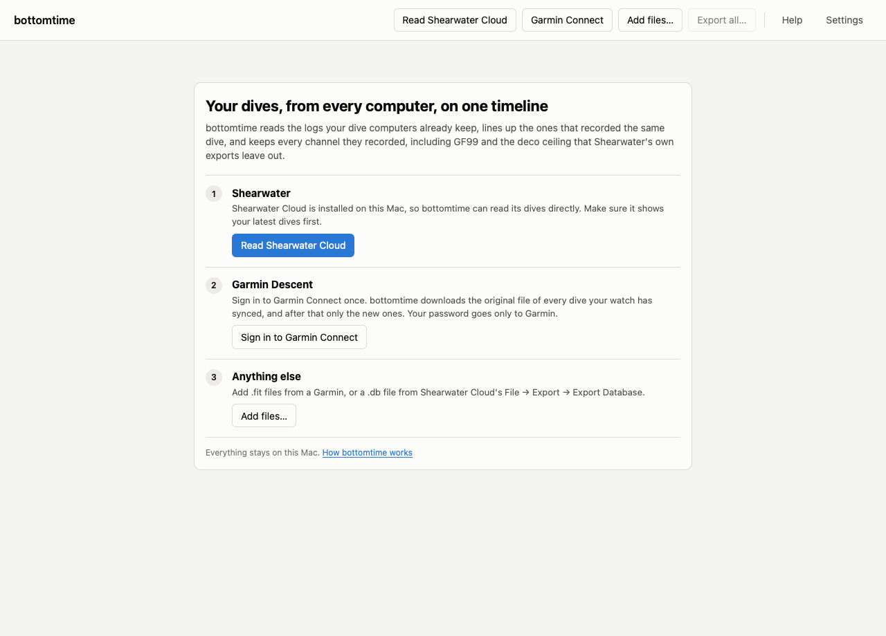
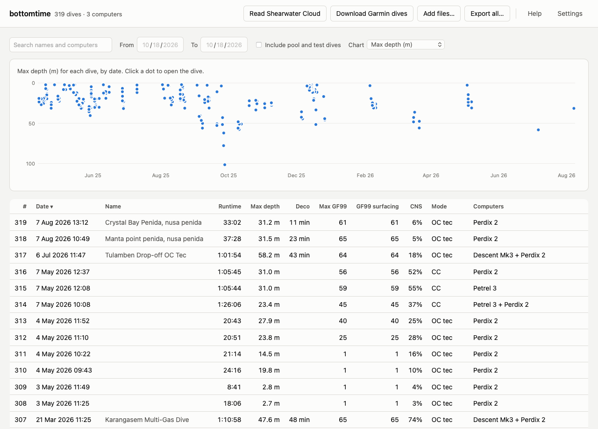
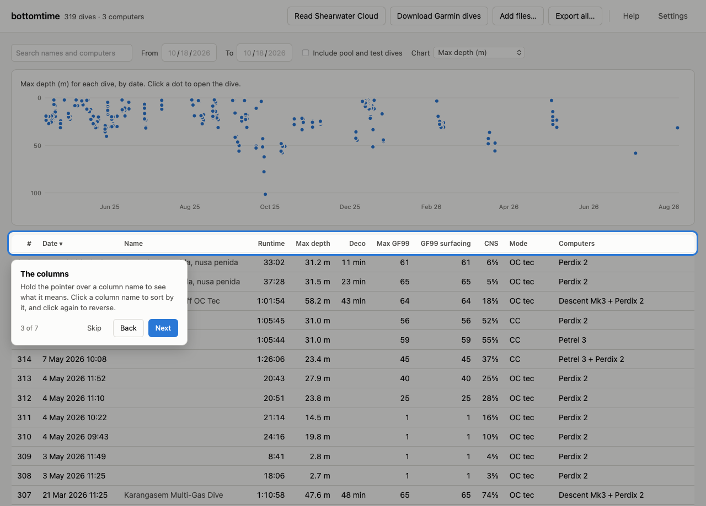
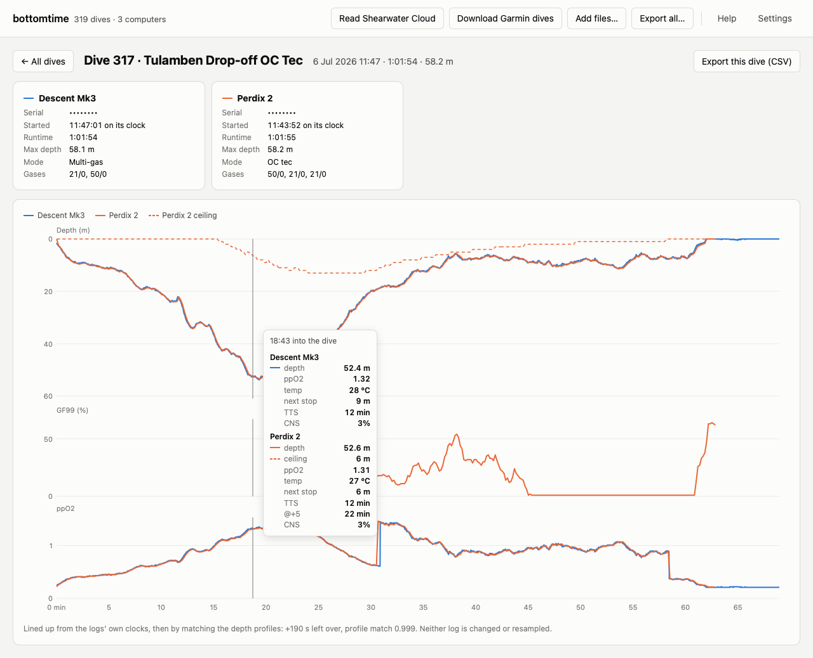
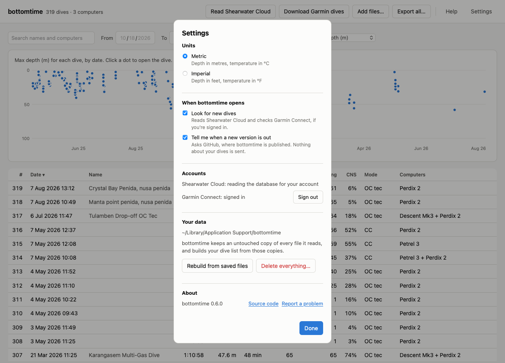

# The bottomtime manual

This manual is for divers using the bottomtime Mac app. You don't need to know
anything about programming to follow it. If you'd rather use the command line
or Python, see [Command line and Python](cli.md).

bottomtime collects the dives from your Shearwater and your Garmin Descent and
shows them together. When you wore both computers on the same dive, it lines
the two logs up on one timeline, so you can see what each one said at the same
moment. It keeps every value your computers recorded, including GF99, the deco
ceiling, and @+5, which Shearwater's own exports leave out. It can save all of
it as spreadsheet files that you can open without bottomtime.

## Contents

1. [Installing bottomtime](#installing-bottomtime)
2. [Getting your dives in](#getting-your-dives-in)
3. [After a dive trip](#after-a-dive-trip)
4. [The dive list](#the-dive-list)
5. [Reading a dive](#reading-a-dive)
6. [Saving your dives as files](#saving-your-dives-as-files)
7. [Settings](#settings)
8. [Updating bottomtime](#updating-bottomtime)
9. [When something goes wrong](#when-something-goes-wrong)
10. [Your data and your privacy](#your-data-and-your-privacy)
11. [Removing bottomtime](#removing-bottomtime)
12. [Terms](#terms)

## Installing bottomtime

bottomtime runs on Macs with Apple silicon (M1 or later) and macOS 11 Big Sur
or newer. To check, open the Apple menu and choose About This Mac. The line
that says Chip should start with "Apple M".

1. Download `bottomtime-mac.zip` from the
   [latest release](https://github.com/snehankekre/bottomtime/releases/latest).
2. Double-click the zip file to unzip it, and drag `bottomtime` into your
   Applications folder.
3. Open bottomtime from Applications. macOS will say that it can't verify
   bottomtime, and offer to move it to the Trash. Click Done, or Cancel on
   older versions of macOS. This happens because bottomtime is made by one
   diver and isn't registered with Apple, which costs money every year.
4. Open System Settings, click Privacy & Security, and scroll down to the
   Security section. You'll see a line saying bottomtime was blocked. Click
   Open Anyway, and enter your Mac's password if it asks.
5. Open bottomtime again. From now on it opens normally.

Everything bottomtime needs is inside the app. You don't have to install
Python or anything else.

## Getting your dives in

The first time you open bottomtime, it shows three ways to add dives. You can
use any of them, in any order, and as often as you like. bottomtime
recognises dives it already has, so reading the same dives twice does no
harm.

### Shearwater

bottomtime reads the dives that Shearwater Cloud's desktop app keeps on your
Mac, so there's nothing to export.

1. Open Shearwater Cloud and download your dives from your computer the way
   you normally do. Check that it shows your latest dive.
2. In bottomtime, click **Read Shearwater Cloud**.

If the button is greyed out, Shearwater Cloud's desktop app isn't installed on
this Mac. You can install it from Shearwater's website, or, if Shearwater
Cloud is on another computer, use its File menu, choose Export, then Export
Database, copy the `.db` file it saves to this Mac, and add it with **Add
files…**.

### Garmin Descent

bottomtime downloads your dives from your Garmin Connect account.

1. Sync your watch with the Garmin Connect app on your phone, as you normally
   do.
2. In bottomtime, click **Garmin Connect**, then enter the email and password
   you use for Garmin Connect.
3. If your account has two-step verification turned on, Garmin sends you a
   code. Type it into bottomtime and click Continue.

bottomtime then downloads the original file of every dive your watch has
synced. The first download takes a little over a second per dive, so a few hundred
dives take a few minutes. After that, the button reads **Download Garmin
dives** and only fetches dives bottomtime doesn't have yet.

Your password goes only to Garmin. bottomtime keeps the sign-in that Garmin
gives back, the same way Garmin's own apps do, so you don't have to sign in
every time.

Garmin Connect also keeps copies of dives from other brands' computers if you
ever imported them with Garmin's dive log import tool. bottomtime skips those
copies and reads those computers directly instead.

### Files

**Add files…** takes `.fit` files from a Garmin computer and `.db` files
exported from Shearwater Cloud. You can pick several files at once.

## After a dive trip

1. Download your dives to Shearwater Cloud and sync your Garmin with Garmin
   Connect, as you normally would.
2. Open bottomtime.

With the default settings, that's all. Each time bottomtime opens, it reads
Shearwater Cloud and checks Garmin Connect for new dives on its own. You can
also click **Read Shearwater Cloud** or **Download Garmin dives** yourself at
any time.

## The dive list

Every dive is one row. When you wore two computers on the same dive, it's
still one row, and the Computers column names both. The count at the top
left counts dives and the different computers they came from.

The first time the list appears, bottomtime gives you a short tour of it. You
can see the tour again at any time from Help, with **Show me around**.

### The columns

Hold the pointer over a column name to see what it means. Click a column name
to sort by it, and click it again to reverse the order.

| Column | What it shows |
|---|---|
| # | Your dives numbered in date order. Pool and test dives aren't numbered. |
| Date | The local time where you dived. |
| Name | The site you typed in Shearwater Cloud. If you didn't type one, the name Garmin Connect gave the dive, unless that name is only something like "Single-Gas Dive". |
| Runtime | How long the dive lasted. When the Garmin logged the dive, this comes from the Garmin, because its clock knows your time zone. The Garmin keeps recording through short surface intervals, so its runtime can be longer than the Shearwater's. |
| Max depth | The deepest reading from any computer on the dive. |
| Deco | Minutes a computer showed a required stop. When two computers disagree, the longer one. |
| Max GF99 | The highest GF99 the Shearwater showed during the dive. |
| GF99 surfacing | The highest GF99 in the last ten minutes of the dive. This matches the end-of-dive GF99 that Shearwater Cloud calculates. |
| CNS | The highest oxygen exposure any computer showed. |
| Mode | The mode the computer was in, such as OC tec or CC. |
| Computers | Every computer that logged the dive. |

### Finding dives

The search box finds dives by site name, computer model, or dive number. The
From and To dates narrow the list to a period, such as one trip.

Dives shorter than 2 minutes or shallower than 2 m are treated as pool or test
dives. They're hidden unless you tick **Include pool and test dives**.

### The chart above the list

The chart puts a dot for every dive in the list, by date. Choose what it shows
with the Chart menu: max depth, GF99 at surfacing, max GF99, runtime, time in
deco, or CNS. Hold the pointer over a dot to see which dive it is, and click
it to open that dive. The chart follows the search and the dates, so you can
compare the dives of a single trip.

## Reading a dive

Click a row in the list, or a dot on the chart, to open a dive.

At the top is one card for each computer that logged the dive. It shows the
computer's serial number, the time the dive started by that computer's own
clock, the runtime and max depth that computer recorded, its mode, and the
gases it had set up, written as oxygen/helium (21/0 is air, 50/0 is EAN50).

Below the cards are up to three charts on the same timeline:

- **Depth.** Each computer has its own colour. The solid line is depth, and
  the dashed line in the same colour is the deco ceiling the Shearwater
  calculated.
- **GF99.** Only Shearwater computers record it.
- **ppO2.** The partial pressure of oxygen each computer reported.

Hold the pointer over the charts and a line follows it through all three
charts, with a box listing what every computer showed at that moment: depth,
ceiling, ppO2, temperature, next stop, time to surface, @+5, NDL, and CNS,
whichever that computer recorded. You can also click the charts and use the
left and right arrow keys to move through the dive in 10-second steps, or
hold Shift for one-minute steps.

When two computers logged the dive, the line under the charts says how they
were lined up. No two dive computers' clocks agree. bottomtime starts from
each computer's own clock, then slides one depth profile along the other until
they match best. "+190 s left over" means bottomtime had to slide one
profile 190 seconds further than the two clocks said, once the time zone was
accounted for. "Profile match 0.999" says how closely the two depth profiles
agree, where 1 would be identical. Neither log is changed. Every reading is
shown at the time its computer recorded it.

The first time you open a dive, bottomtime gives you a short tour of this
page too.

Click **← All dives**, or press Esc, to go back to the list.

## Saving your dives as files

bottomtime can save your dives as CSV files, which open in Excel, Numbers, or
Google Sheets. The files are yours and stay readable without bottomtime,
Shearwater Cloud, or Garmin Connect.

**Export this dive (CSV)**, on a dive's page, saves one file with every
reading from every computer on that dive. Each row is one reading from one
computer. The `dive_time_s` column puts every computer on the same timeline,
in seconds from the start of the dive, so you can sort or chart them together.

**Export all…**, at the top of the window, saves a zip file. Inside are
`dives.csv`, with one row per dive and the same columns as the dive list, and
a `dives` folder with one file per dive.

Values in exported files are always metric. Most column names end in their
unit, such as `depth_m` for metres, `temp_c` for °C, and `tts_s` for seconds.
Garmin and Shearwater record different things, so each computer fills in its
own columns and leaves the others empty.

## Settings

**Units** switches depth between metres and feet and temperature between °C
and °F everywhere in the app. Exported files stay metric.

**Look for new dives** makes bottomtime read Shearwater Cloud and check Garmin
Connect each time it opens. It only starts once you've added dives yourself,
so bottomtime never reads Shearwater Cloud before you've asked it to.

**Tell me when a new version is out** asks GitHub, where bottomtime is
published, whether there's a newer version. Nothing about your dives is sent.

**Accounts** shows which Shearwater Cloud account bottomtime reads, and lets
you sign in to or out of Garmin Connect.

**Your data** shows the folder where bottomtime keeps everything, with a
button to open it in Finder.

- **Rebuild from saved files** throws away the dive list and builds it again
  from the files bottomtime saved. Nothing is downloaded. Use it if something
  looks wrong after an update.
- **Delete everything…** deletes every dive and saved file in bottomtime,
  signs out of Garmin Connect, and resets the settings. It asks you to
  confirm first. Your dives in Shearwater Cloud and Garmin Connect aren't
  touched, so you can read them again.

**About** shows which version you have, with links to the source code and to
report a problem.

## Updating bottomtime

When a new version is out, a line at the top of the window says so. Click
**Download it**, then replace the bottomtime in your Applications folder with
the new one, the same way you installed it. macOS may ask you to allow it in
Privacy & Security again.

The first time a new version opens, it may say "Updating your dives for this
version of bottomtime" while it rebuilds your dive list from the files it
saved. This takes a minute or so and downloads nothing.

## When something goes wrong

When something fails, a line at the top of the window says what happened.
Click **Details** to see the technical message, and **Report a problem** to
open a page on GitHub with that message filled in, where you can describe what
you were doing. You'll need a free GitHub account to send it.

The messages you're most likely to see:

**"Shearwater Cloud's desktop app wasn't found on this Mac."** bottomtime
looks for Shearwater Cloud's dives in the folder Shearwater Cloud's Mac app
keeps them in, and found none. Install Shearwater Cloud, or export a database
from it on another computer and use **Add files…**.

**"…couldn't read a database. If Shearwater Cloud is syncing, wait for it to
finish and try again."** Shearwater Cloud was busy writing to its database.
Wait until it has finished syncing and click **Read Shearwater Cloud** again.

**"Check the email and password, then try again."** Garmin didn't accept the
sign-in. Use the email and password you use at connect.garmin.com.

**"Garmin is limiting sign-ins right now."** Garmin blocks sign-ins for a
while after several attempts in a row. Wait a few minutes.

**"Garmin didn't accept the saved sign-in. Click Garmin Connect and sign in
again."** Garmin's sign-in expires now and then, or ends when you change your
password. bottomtime has signed you out, so click **Garmin Connect** and sign
in again.

**"…needs Garmin Connect, and bottomtime couldn't reach it."** Check your
internet connection. If it works and the message keeps coming back, Garmin may
have changed something on their side. bottomtime signs in to Garmin Connect
the way Garmin's own apps do, without an official arrangement with Garmin, so a change at Garmin can stop it working until
bottomtime is updated. Adding `.fit` files with **Add files…** still works
when that happens. Report a problem so it gets fixed.

**"bottomtime couldn't read that file."** bottomtime reads `.fit` files from
Garmin computers and `.db` files exported from Shearwater Cloud. Other files,
such as Shearwater's XML or CSV exports, can't be added.

**"3 of 40 files couldn't be read. The others were added."** Most files went
in. The ones that didn't were either damaged or not dive logs that bottomtime
reads.

**The dive list looks wrong after an update.** Open Settings and click
**Rebuild from saved files**.

**macOS says bottomtime can't be opened.** Follow steps 3 to 5 of
[Installing bottomtime](#installing-bottomtime).

## Your data and your privacy

Everything bottomtime has stays on your Mac, in the folder
`~/Library/Application Support/bottomtime`. That folder holds:

- `dives.db`, your dive list.
- `archive`, an untouched copy of every file bottomtime has read: each
  original Garmin file and each copy of Shearwater Cloud's database. Your
  dive list is built from these, which is why it can always be rebuilt.
- `garmin`, your Garmin Connect sign-in, if you signed in.
- `settings.json`, your settings.

bottomtime sends nothing about your dives anywhere. It contacts Garmin Connect
only to download your dives, and GitHub only to check for a new version,
which you can turn off in Settings.

## Removing bottomtime

To remove bottomtime and everything it saved, open Settings, click **Delete
everything…** and confirm, then drag bottomtime from Applications to the
Trash. Your dives in Shearwater Cloud and Garmin Connect stay where they are.

## Terms

| Term | Meaning |
|---|---|
| GF99 | How close your leading tissue compartment is to its Bühlmann limit at your current depth, as a percentage. 100 means you are at the limit. |
| Ceiling | The shallowest depth the computer would let you ascend to right now. |
| @+5 | What your time to surface would be if you stayed five more minutes at this depth. |
| TTS | Time to surface, including every stop. |
| NDL | No-decompression limit: the minutes left before you'd need a stop. |
| CNS | Your oxygen exposure as a percentage of the allowed limit. |
| ppO2 | The partial pressure of oxygen in what you're breathing, in bar. |
| CSV | A plain text spreadsheet file that Excel, Numbers, and Google Sheets open. |
| FIT | The file format Garmin computers record dives in. |
